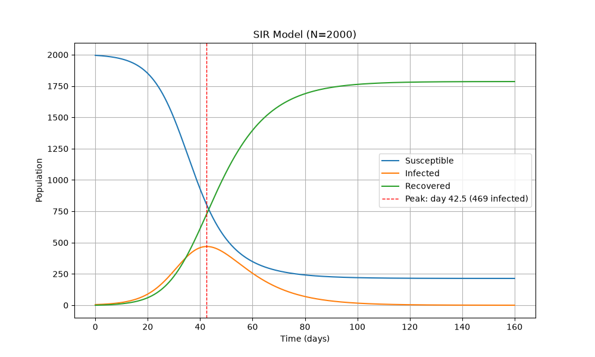
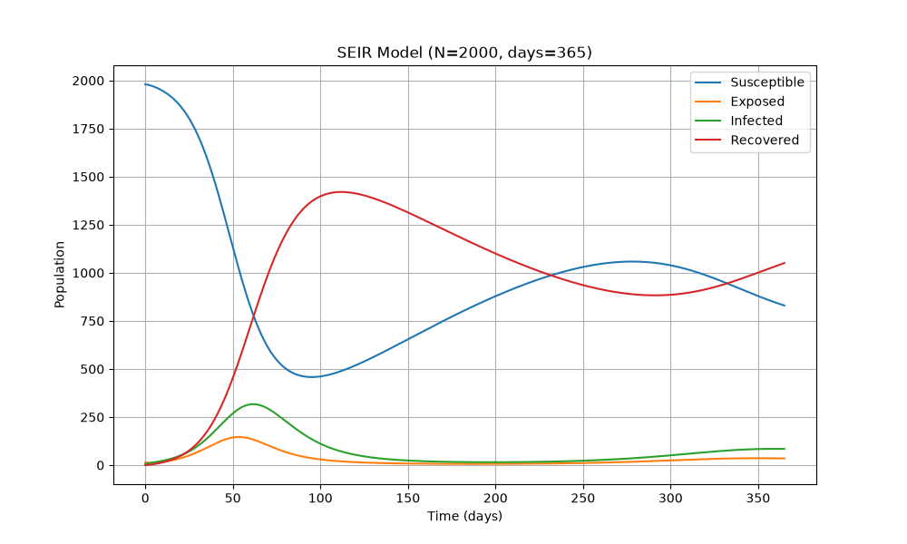
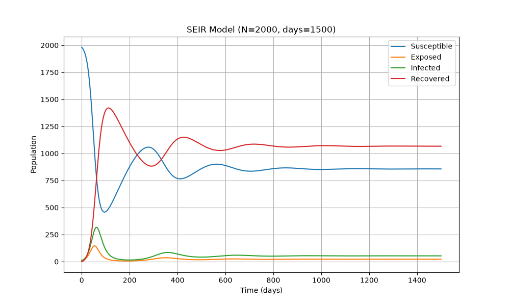
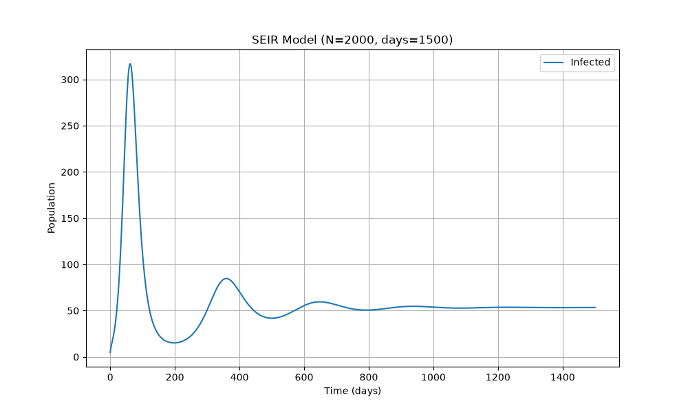
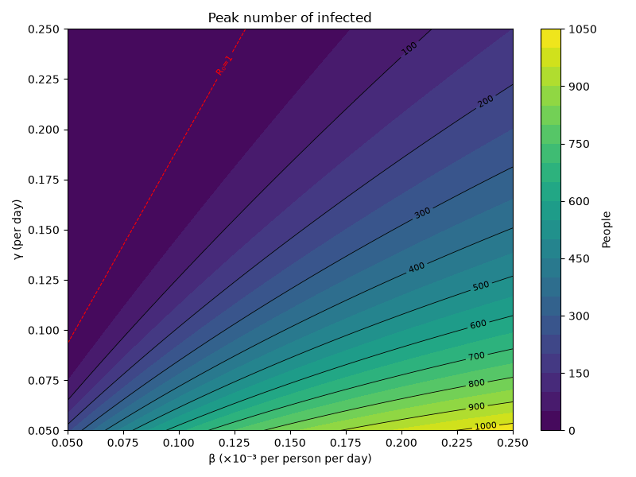
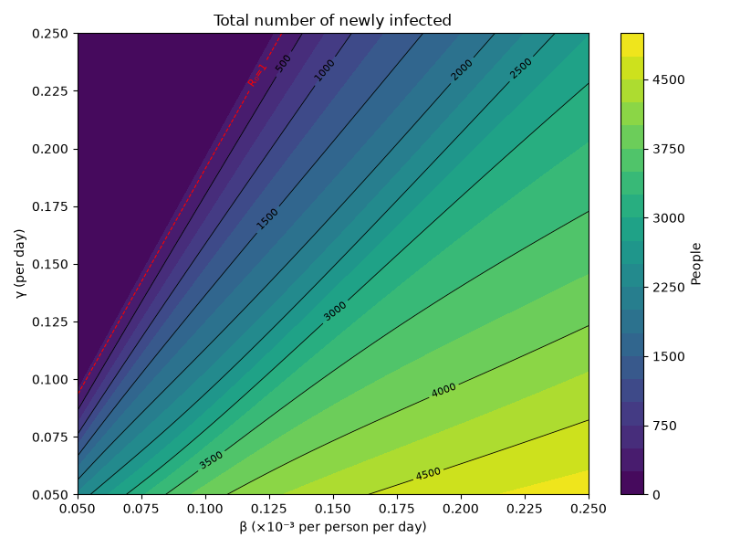

# BMI500 Week 7 model-based machine learning HW1

Name: Jangwon Lim

Email: jlim249@emory.edu

Question number: HW1

## Results and Answers to discussion items
### Part A
I implemented forward Euler and Runge-Kutta solvers and compared them with the solver from scipy (solve_ivp) on the Part B problem with dt = 0.1 day.

| Method (dt = 0.1) | Max abs. error vs. solve_ivp |
|---|---|
| Forward Euler | ~10.7 people |
| Runge-Kutta | ~2 × 10⁻⁵ people |

Runge-Kutta matches the reference with a very small error, so all later parts use this method with dt = 0.1.

### Part B


### Part C
**(i)** I(t) peaks on day 42.5 with 469 infected people. After that point, new infections no longer outpace recoveries. From dI/dt = I($\beta$ S - $\gamma$), infections grow while ($\beta$ S > $\gamma$) and decline once S falls below $\gamma / \beta$ = $N/R_0 = 800$ with $N = 2000$ and $R_0=2.5$. In the simulation, S at the peak is about 802, which matches this threshold. This means that the peak is set by the balance between transmission and recovery rate. A larger transmission rate or smaller recovery rate would push the threshold lower, so more people must be infected before the epidemic turns. The timing depends on how fast the outbreak grows at the start. With almost everyone susceptible, infections grow at about $\beta N - \gamma$ = 0.15 per day. 

**(ii)** $R_0=2.5$. This means one infected person in a fully susceptible population infects 2.5 others on average before recovering. Because it's greater than one, each generation of cases is larger than the last, so the outbreak grows until susceptible people run out. A larger value of $R_0$ produces faster spread, an earlier and higher peak, and more total infections as a result. To control the epidemic, it must be pushed below 1, either by reducing $\beta$ or increasing $\gamma$ through treatment or isolation. $R_0$ also sets the threshold seen in the previous part.

**(iii)** S stays around 2000 for the first two weeks, then drops rapidly between day 20 and 60, and becomes flat afterwards. "I" rises relatively in a slower pace, peaks on day 42, and falls back toward zero by day 160. R mirrors S, showing a very similar trend but in the opposite direction. By the end of the simulation, 214 people were never infected. The three compartments drive each other. New infections need contact between S and I, so the outbreak accelerates while both are large (in dS/dt). As infections move people from S to I and then to R, the portion of susceptibles shrinks and each infected person finds fewer people to infect. Once S drops below 800, recovered people outpace new infections and the outbreak ends because there's not many susceptibles remain to maintain transmission. 


### Part D
**(i)** I implemented the SEIR model by adding an exposed compartment E and equal birth and death rates. All newborns are included in S, and deaths are removed from every compartment based on the derivatives, so the total population stays at 2000.

**(ii)** 




**(iii)**
| Wave | Day | Peak I |
|---|---|---|
| 1 | 61.6 | 316.9 |
| 2 | 359.2 | 84.8 |
| 3 | 648.1 | 59.6 |
| 4 | 938.0 | 54.7 |
| 5 | 1228.3 | 53.7 |

The model produces one large wave followed by smaller waves with the interval of 290 to 300 days. The first wave is by far the largest because it starts with an almost entirely susceptible population. After it, S drops below 500, and infections drops rapidly. Births then refill S at about 10 people per day while deaths remove those who are immune from R. Once S climbs back above the threshold (800) and then reaches the second highest number of susceptibles, a second, smaller wave starts. Each wave after the second one starts with the smaller number of susceptible people, so it leads to a smaller and shorter period of the epidemic wave. Only two waves appeared within 365 days, and the 1500-day simulation shows the oscillations of I dying out toward a steady state. 

**(iv)** From Part C, $R_0$ was 2.5 and it's now 2.33 in this part with more factors included. This difference comes from deaths. A fraction $\sigma / (\sigma + \mu)$ of exposed people survive to become infectious, and their infectious period is shortened from $1/\gamma$ to $1/(\gamma + \mu)$. Both reduce the number of new infections each case can cause. 

The long-term S is 856.92 and $N/R_0$ is 856.8, which are almost equal to each other. In the long run, the epidemic reaches a steady state where the number of infected people stays nearly constant. For that to happen, each infected person must infect exactly one other person on average. If S falls below it, infections fade out and births refill S. If S rise above it, a new wave starts. This is why S oscillates around 857 and eventually settles there.

**(v)** The exposed compartment adds an average 4-day delay ($1/\sigma$) before a new case becomes infectious. This basically slows down early growth. In this part, the first peak occurs later than Part B and have fewer infected people. It also comes from other factors ($\mu$ or different initial conditions), but $\sigma$ also affects the delay. 

Birth and deaths are what make repeated waves possible. Without them, as shown in Part B, S only decreases and the epidemic ends after one big wave. With them, susceptible newborns keep replacing immune individuals who die, so the susceptible refills and the disease can return, which eventually make it persist at a stable level. 

Instead of $\mu=0.005$ per day, we should use the realistic lifespan of about 80 years. Then, $\mu$ becomes approximately $3.4 * 10^-5$ per day. This means only about 0.07 newborns per day would be included in S. Refilling S above the threshold would then take decades, so within 1500 days the model would show only one wave, like Part B. In real populations, repeated waves usually come from low immunity, seasonality, or new variants like we've all experienced during Covid19. 

### Part E
**(i)** I ran the SEIR model with a given grid of parameter values. For each pair, I recorded the peak number of infected people and the total number of new infections. The total was computed by integrating the new-infection rate over time using Simpson's rule. 

**(ii)**



The red dashed line marks $R_0 = 1$. To the upper left of this line, $\beta$ is low and $\gamma$ is high, so $R_0$ < 1. Each infected person passes the disease to fewer than one other person on average, so the outbreak dies out on its own. 

**(iii)** Lowering $\beta$ means lowering the transmission rate, which I can think of it as social distancing, masks, or anything that can help reduce the transmission rate. Raising $\gamma$ indicates faster treatment or effective isolation that shortens the infectious period. On the plot, the contours follow the $\beta/\gamma$ ratio, so a given relative reduction in $\beta$ and a given relative increase in $\gamma$ have a similar effect on the peak. Therefore, combining social distancing and treatment is the most reliable way to move firmly below the threshold. 


## Hypothesis revisited

### Infection peak: partially supported
I predicted that infections would grow by about 15% per day, reach the peak in about a month, stop growing when S fell to 800, and that fewer than half of the roughly 1200 people infected by then would still be sick at the peak. The general mechanism was correct. S at peak was 802, and the peak size of 469 people was below my upper bound of 600. The timing was off. The peak came on 42.5 day rather than around 30th. The epidemic slows well before the peak, so pure exponential growth underestimates the time to peak. The lesson that I learned is that early exponential growth cannot be extrapolated, because the growth rate itself shrinks as susceptibles are used up, so the peak comes later than a constant-rate esitmate suggests. 

### Waves in the SEIR model: supported 
I expected several waves because births add susceptible newborns while death remove immune people, and I expected the exposed stage to delay the waves. The 1500-day simulation showed five waves, and the first wave came later than the Part B peak, as discussed in Results and Discussion section. One thing I did not expect was that the waves would shrink so quickly. The lesson that I learned from this is that a single added mechanism can change a model's long-term behavior from one wave to a few oscillations, and that behavior depends strongly on parameter choices such as lifespan. 

### $\beta$ vs. $\gamma$: rejected
I expected $\gamma$ to affect the peak more than $\beta$ because $\gamma$ changes both $R_0$ and how long each person stays infectious. But how long people stay sick ($1/\gamma$) is already part of $R_0=\beta N /\gamma$, so these are the same effect, not two separate ones. Halving $\beta$ and doubling $\gamma$ both halve $R_0$ in teh same way. The contour plots confirm that the peak contours follow the $\beta/\gamma$ ratio, so $\beta$ and $\gamma$ have a similar effect on the peak. I learned that parameters act through combined quantities like $R_0=\beta N /\gamma$, so reasoning about one parameter alone can make its effect bigger than it actually is. 


## How to run

```bash
git clone https://github.com/JangwonLim/bmi500-sir-seir-modeling.git
cd bmi500-sir-seir-modeling
python -m venv .venv
source .venv/bin/activate
pip install -r requirements.txt
```

Run the notebooks in order: `partA.ipynb`, `partB.ipynb`, `partC.ipynb`, `partD.ipynb`, `partE.ipynb`.
Shared model and solver functions are in `utils.py`. Figures are saved to `figures/`.
- ...


## AI statement
Statement: Claude was used to complete this homework. The full chat is available at https://claude.ai/share/733ce3f1-0127-44c5-b979-3e9f17bffa26